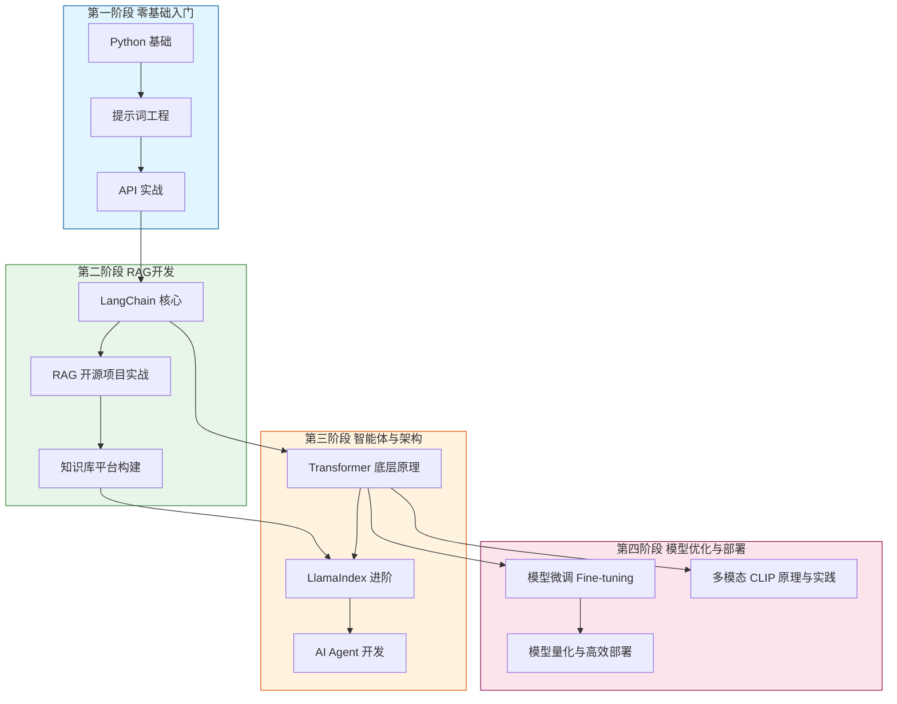

# 🚀 AI 大模型应用开发学习路线 (LLM Dev Roadmap)

> 一条从零基础到模型优化的 AI 大模型应用开发开源学习路径：**4 个阶段、12 个模块、20 个高 Star 项目**。
> 本项目不仅提供项目清单，更附带了以过来人视角总结的**难度分级、必学建议与避坑指南**。
> *注：Star 数据采集于 2026-11-20，通过 GitHub 官方 API 实时获取。*

---

## 📖 目录 (Table of Contents)

- [🗺️ 核心学习路线图 (Roadmap)](#️-核心学习路线图-roadmap)
- [📚 详细学习路径与项目清单](#-详细学习路径与项目清单)
- [🎯 学习成果自测 Checklist](#-学习成果自测-checklist)
- [🤝 如何贡献 (Contributing)](#-如何贡献-contributing)
- [License](#license)

---

## 🗺️ 核心学习路线图 (Roadmap)

建议按以下依赖关系循序渐进，切勿跳跃式学习：

---

## 📚 详细学习路径与项目清单

**💡 标签说明：**

- 🌟 **必学**：该模块的核心基石，强烈建议动手跑通。
- 💡 **推荐**：作为扩展视野或进阶提升的优质替代方案。
- 🟢 入门 / 🟡 进阶 / 🔴 高阶：项目理解与实操的难度等级。

### 🐍 第一阶段：零基础入门

| 学习模块      | 推荐项目                                                                                                        | 难度    | 属性    | 一句话心得 / 避坑指南                                                                 |
| --------- | ----------------------------------------------------------------------------------------------------------- | ----- | ----- | ---------------------------------------------------------------------------- |
| Python 基础 | [jackfrued/Python-100-Days](https://github.com/jackfrued/Python-100-Days)                                   | 🟢 入门 | 🌟 必学 | 经典中文教程。避坑：不用全看！重点看前 15 天的语法和基础，后面的 Web 开发部分可以先跳过，直接进入 AI 库的学习。               |
| Python 基础 | [tangyudi/Ai-Learn](https://github.com/tangyudi/Ai-Learn)                                                   | 🟢 入门 | 💡 推荐 | 适合小白建立大局观。心得：跟着里面的实战案例敲代码，能快速消除对 AI 的陌生感。                                    |
| 提示词工程     | [dair-ai/Prompt-Engineering-Guide](https://github.com/dair-ai/Prompt-Engineering-Guide)                     | 🟢 入门 | 🌟 必学 | 提示词就是新时代的"编程语言"。心得：重点看 Few-shot 和 Chain-of-Thought (CoT) 章节，这是后面写 Agent 的基础。 |
| 提示词工程     | [anthropics/prompt-eng-interactive-tutorial](https://github.com/anthropics/prompt-eng-interactive-tutorial) | 🟢 入门 | 💡 推荐 | Anthropic 官方互动教程。心得：别光看文档，直接用 Jupyter Notebook 跑起来，立刻就能看到 Prompt 调整后的效果对比。   |
| API 实战    | [openai/openai-cookbook](https://github.com/openai/openai-cookbook)                                         | 🟢 入门 | 🌟 必学 | 官方 API"字典"。避坑：不要从头读到尾，遇到具体需求（如流式输出、Function Calling）时，直接按目录搜对应的 Demo 抄代码。    |

### 🔍 第二阶段：RAG 开发

| 学习模块      | 推荐项目                                                                                      | 难度    | 属性    | 一句话心得 / 避坑指南                                                                  |
| --------- | ----------------------------------------------------------------------------------------- | ----- | ----- | ----------------------------------------------------------------------------- |
| LangChain | [langchain-ai/langchain](https://github.com/langchain-ai/langchain)                       | 🟡 进阶 | 🌟 必学 | 目前最主流的 LLM 应用框架。避坑：LangChain 更新极快，很多网上的老教程代码会报错，一定要看官方最新文档，建议先只学 LCEL 语法。     |
| LangChain | [chatchat-space/Langchain-Chatchat](https://github.com/chatchat-space/Langchain-Chatchat) | 🟡 进阶 | 💡 推荐 | 适合想快速搭建私有知识库的人。心得：直接按文档一键部署，先跑通体验，再去研究它内部的 RAG 检索是怎么做的。                       |
| 项目实战      | [infiniflow/ragflow](https://github.com/infiniflow/ragflow)                               | 🔴 高阶 | 💡 推荐 | 企业级 RAG 引擎。心得：它的深度文档解析（如处理复杂 PDF 表格）做得极好，做严肃商业项目可以参考它的架构。                     |
| 项目实战      | [HKUDS/LightRAG](https://github.com/HKUDS/LightRAG)                                       | 🟡 进阶 | 💡 推荐 | 知识图谱 + 双层检索。避坑：如果你的数据没有明显的实体关系（比如只是一堆散文），不要用这个，反而增加复杂度。适合处理长文本和强逻辑关系的文档。      |
| 知识库构建     | [run-llama/llama_index](https://github.com/run-llama/llama_index)                         | 🟡 进阶 | 🌟 必学 | RAG 构建神器，数据连接器极强。心得：LangChain 偏重流程编排，LlamaIndex 偏重数据索引与检索。做 RAG 时，两者结合使用效果最好。 |

### 🤖 第三阶段：智能体与架构

| 学习模块        | 推荐项目                                                                    | 难度    | 属性    | 一句话心得 / 避坑指南                                                          |
| ----------- | ----------------------------------------------------------------------- | ----- | ----- | --------------------------------------------------------------------- |
| AI Agent    | [microsoft/autogen](https://github.com/microsoft/autogen)               | 🟡 进阶 | 💡 推荐 | 微软多智能体框架。心得：非常适合研究多 Agent 之间的通信机制，看它的官方示例能学到很多架构设计思路。                 |
| AI Agent    | [FoundationAgents/MetaGPT](https://github.com/FoundationAgents/MetaGPT) | 🟡 进阶 | 💡 推荐 | 角色扮演类 Agent 标杆。心得：看看它是如何通过 Prompt 把一个任务拆解成"产品经理、架构师、程序员"等角色的，非常开脑洞。   |
| AI Agent    | [crewAIInc/crewAI](https://github.com/crewAIInc/crewAI)                 | 🟡 进阶 | 🌟 必学 | 比 AutoGen 更易上手。避坑：不要把复杂的业务逻辑硬塞给 CrewAI，它更适合做流程清晰、角色明确的任务编排（比如自动化写周报）。 |
| Transformer | [datawhalechina/happy-llm](https://github.com/datawhalechina/happy-llm) | 🔴 高阶 | 🌟 必学 | 中文手搓大模型教程。心得：想彻底弄懂 Attention 机制，一定要跟着敲一遍，跑通一次前向传播，比看 100 篇原理解析都有用。    |
| Transformer | [rasbt/LLMs-from-scratch](https://github.com/rasbt/LLMs-from-scratch)   | 🔴 高阶 | 💡 推荐 | 全球知名的硬核教程。避坑：需要一定的 PyTorch 基础，如果看不懂，先回去补 PyTorch，不要硬啃。                |

### ⚙️ 第四阶段：模型优化与部署

| 学习模块       | 推荐项目                                                                    | 难度    | 属性    | 一句话心得 / 避坑指南                                                  |
| ---------- | ----------------------------------------------------------------------- | ----- | ----- | ------------------------------------------------------------- |
| 微调         | [hiyouga/LLaMA-Factory](https://github.com/hiyouga/LLaMA-Factory)       | 🟡 进阶 | 🌟 必学 | 微调界的"傻瓜相机"。心得：支持模型极多，UI 界面极其友好。新手第一次跑微调（LoRA），用这个绝对有成就感，不易报错。 |
| 量化         | [microsoft/BitNet](https://github.com/microsoft/BitNet)                 | 🔴 高阶 | 💡 推荐 | 微软 1-bit 大模型推理框架。心得：代表了前沿的极限量化技术，面试时聊到这个能极大加分。                |
| 量化         | [kvcache-ai/ktransformers](https://github.com/kvcache-ai/ktransformers) | 🔴 高阶 | 💡 推荐 | 异构推理优化。避坑：量化部署非常吃硬件配置，如果没有相应的 GPU 环境，建议先看懂它的架构文档，不要盲目实操。      |
| 多模态 (CLIP) | [mlfoundations/open_clip](https://github.com/mlfoundations/open_clip)   | 🟡 进阶 | 🌟 必学 | 跨模态基石。心得：理解"图文对齐"的最佳切入点，重点跑一下 Zero-shot 分类和图文检索的 Demo。        |
| 多模态 (CLIP) | [OFA-Sys/Chinese-CLIP](https://github.com/OFA-Sys/Chinese-CLIP)         | 🟡 进阶 | 💡 推荐 | 中文多模态首选。避坑：做中文电商图文检索或跨模态搜索，直接用这个，别用原版 CLIP，中文语义对齐效果好很多。       |

---

## 🎯 学习成果自测 Checklist

为了证明你真正掌握了上述路线，而不是仅仅"看过"，建议对照以下标准进行自测：

- [ ] **第一阶段**：能熟练调用 OpenAI / 国产大模型 API，并结合 Gradio 或 Streamlit 写出一个带有上下文记忆的对话机器人。
- [ ] **第二阶段**：能从零部署并跑通 Langchain-Chatchat 或 Dify，并能把一份 100 页的私有 PDF 准确灌入，实现精准问答。
- [ ] **第三阶段**：能使用 CrewAI 或 AutoGen 搭建一个包含 2 个以上角色的 Agent 团队，协作完成一项自动化任务（如：自动写代码并测试）。
- [ ] **第四阶段**：能使用 unsloth 对开源小模型（如 Qwen-1.8B）进行 LoRA 微调，并通过 llama.cpp 完成量化，最终部署在本地笔记本上运行。

---

## 🤝 如何贡献 (Contributing)

开源项目离不开大家的支持！我们欢迎一切形式的贡献：

- **补充优质项目**：如果你觉得有比清单里更好的替代项目，欢迎提交 PR。
- **分享避坑经验**：如果你在学习上述项目时踩了坑，欢迎在 Issues 中分享，我们会更新到表格中。
- **纠正错误**：发现链接失效、介绍有误，请随时指出。

**操作指引：**

1. 提交 PR 前，请先阅读 [CONTRIBUTING.md](CONTRIBUTING.md)（如果暂无，可直接提 Issue）。
2. 如果你觉得本项目对你有帮助，请点亮右上角的 Star ⭐，这是对我们最大的鼓励！

---

## License

本项目以 [MIT License](LICENSE) 开源，内容部分遵循 [CC BY 4.0](https://creativecommons.org/licenses/by/4.0/)。
