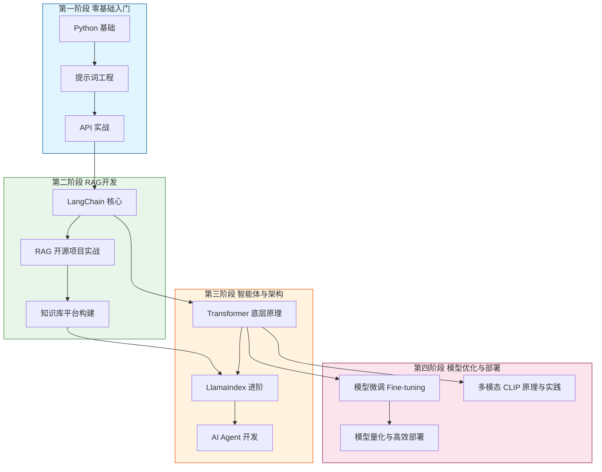

# 🚀 AI 大模型应用开发学习路线 (LLM Dev Roadmap)

> 一条从零基础到模型优化的 AI 大模型应用开发开源学习路径：**4 个阶段、12 个模块、20 个高 Star 项目**。
> 本项目不仅提供项目清单，更附带了以过来人视角总结的**难度分级、必学建议与避坑指南**。
> *注：Star 数据采集于 2026-11-20，通过 GitHub 官方 API 实时获取。*

---

## 📖 目录 (Table of Contents)
- [🗺️ 核心学习路线图 (Roadmap)](#️-核心学习路线图-roadmap)
- [📚 第一阶段：零基础入门](#-第一阶段零基础入门)
- [🔍 第二阶段：RAG 开发](#-第二阶段rag-开发)
- [🤖 第三阶段：智能体与架构](#-第三阶段智能体与架构)
- [⚙️ 第四阶段：模型优化](#️-第四阶段模型优化)
- [🎯 学习成果自测 Checklist](#-学习成果自测-checklist)
- [🤝 如何贡献](#-如何贡献)

---

## 🗺️ 核心学习路线图 (Roadmap)

建议按以下依赖关系循序渐进，切勿跳跃式学习：

💡 标签说明：
🌟 必学：该模块的核心基石，强烈建议动手跑通。
💡 推荐：作为扩展视野或进阶提升的优质替代方案。
🟢 入门 / 🟡 进阶 / 🔴 高阶：项目理解与实操的难度等级。

📚 第一阶段：零基础入门
序号	学习模块	推荐项目	Star	难度	属性	💡 一句话心得 / 避坑指南
1	Python 基础	Python-100-Days	187.9k	🟢	🌟 必学	中文圈最系统的入门课。避坑：不用全看完！重点啃前 15 天语法，后面的 Web 开发可跳过，直接衔接 AI 常用库（NumPy/Pandas）。
2	提示词工程	Prompt-Engineering-Guide	80.2k	🟢	🌟 必学	提示词就是新时代的“编程语言”。心得：重点看 CoT（思维链）和 ReAct，这是后面学 Agent 的必备基础。
3	提示词实战	llm-cookbook	24.9k	🟢	💡 推荐	吴恩达课程中文版。心得：理论结合代码，建议跟着 Jupyter Notebook 边看边敲，比纯看文档效果好十倍。
4	API 实战	openai-cookbook	77.2k	🟢	🌟 必学	官方 API “字典”。避坑：不要从头读到尾！遇到具体需求（如流式输出、Function Calling）时，直接按目录搜 Demo 抄代码。
5	入门综合	generative-ai-for-beginners	123.9k	🟢	💡 推荐	微软官方 21 节课。心得：非常适合作为第一阶段的收尾，用来查漏补缺，检验自己的知识体系是否有盲区。
🔍 第二阶段：RAG 开发
序号	学习模块	推荐项目	Star	难度	属性	💡 一句话心得 / 避坑指南
6	LangChain	langchain	149.9k	🟡	🌟 必学	应用开发事实标准。避坑：版本更新极快，网上的老教程经常报错。建议重点学最新的 LCEL 语法，少走弯路。
7	项目实战	Langchain-Chatchat	38.7k	🟡	💡 推荐	中文本地知识库标杆。心得：直接一键部署跑通，重点去研究它内部的 Retriever 检索流程和 Prompt 拼装逻辑。
8	RAG 引擎	RAGFlow	94.5k	🔴	💡 推荐	生产级 RAG 引擎。心得：它的深度文档解析（DeepDoc）做得极好，做商业项目时，参考它怎么处理复杂 PDF 表格和图文混排。
9	知识库平台	Dify	161.5k	🟡	🌟 必学	可视化 LLM 应用开发平台。心得：先用它零代码搭一个知识库机器人，体验完整流程，再去读源码理解工程化实现。
10	企业级落地	Onyx	33.5k	🔴	💡 推荐	企业级开源问答平台。心得：看看它是如何对接几十种企业数据源（Slack、Jira、Google Drive）的，对做 ToB 项目极有帮助。
🤖 第三阶段：智能体与架构
序号	学习模块	推荐项目	Star	难度	属性	💡 一句话心得 / 避坑指南
11	LlamaIndex	llama_index	53.0k	🟡	🌟 必学	专注数据索引与检索。心得：它和 LangChain 互补。如果你觉得 LangChain 检索不够精准，试试 LlamaIndex 的高级检索策略。
12	AI Agent	AutoGPT	188.1k	🔴	💡 推荐	自主智能体鼻祖。心得：重点看它的任务拆解、自我反思循环和工具调用逻辑。理解 Agent 的底层骨架必看。
13	Agent 框架	crewAI	61.1k	🟡	🌟 必学	多智能体协作框架。避坑：适合“角色扮演”明确、流程清晰的任务（如写报告、做调研）。不要硬塞给复杂业务，容易失控。
14	Transformer	transformers	169.3k	🟡	🌟 必学	工业界绝对标准。心得：别一上来就啃源码。先熟练掌握 Pipeline 的用法，把推理跑通，再去看底层模型架构。
15	Transformer 手写	nanoGPT	64.9k	🔴	🌟 必学	Karpathy 大神的千行代码。避坑：需要一点 PyTorch 基础。亲手跑通一次前向传播，对 Attention 机制的理解会超过读十篇论文。
⚙️ 第四阶段：模型优化
序号	学习模块	推荐项目	Star	难度	属性	💡 一句话心得 / 避坑指南
16	微调	unsloth	79.8k	🟡	🌟 必学	高效微调神器。心得：显存优化极好，速度极快。新手第一次体验 LoRA 微调，强烈建议用它，不容易报错，成就感满满。
17	强化学习微调	trl	19.8k	🔴	💡 推荐	官方 RLHF 训练库。心得：想做 SFT、DPO 等高级后训练策略，这是标准工具箱，代码极其规范，适合进阶。
18	量化部署	llama.cpp	135.8k	🔴	🌟 必学	大模型本地部署基石。心得：GGUF 量化格式的发源地。想在普通笔记本上跑大模型，或者想做边缘设备部署，必学。
19	多模态	CLIP	34.6k	🟡	🌟 必学	跨模态原理原点。心得：重点理解它的“对比学习”思想，搞懂图文是怎么对齐到同一个特征空间的，这是多模态的根基。
20	多模态实践	open_clip	14.3k	🟡	💡 推荐	CLIP 的开源复现。避坑：原版 CLIP 中文能力弱，如果在中文场景下实践，建议直接搜 Chinese-CLIP 项目进行替代。
🎯 学习成果自测 Checklist
为了证明你真正掌握了上述路线，而不是仅仅“看过”，建议对照以下标准进行自测：

□ 第一阶段：能熟练调用 OpenAI/国产大模型 API，并结合 Gradio 或 Streamlit 写出一个带有上下文记忆的对话机器人。
□ 第二阶段：能从零部署并跑通 Langchain-Chatchat 或 Dify，并能把一份 100 页的私有 PDF 准确灌入，实现精准问答。
□ 第三阶段：能使用 CrewAI 或 AutoGen 搭建一个包含 2 个以上角色的 Agent 团队，协作完成一项自动化任务（如：自动写代码并测试）。
□ 第四阶段：能使用 unsloth 对开源小模型（如 Qwen-1.8B）进行 LoRA 微调，并通过 llama.cpp 完成量化，最终部署在本地笔记本上运行。
🤝 如何贡献 (Contributing)
开源项目离不开大家的支持！我们欢迎一切形式的贡献：

补充优质项目：如果你觉得有比清单里更好的替代项目，欢迎提交 PR。

分享避坑经验：如果你在学习上述项目时踩了坑，欢迎在 Issues 中分享，我们会更新到表格中。

纠正错误：发现链接失效、介绍有误，请随时指出。

操作指引：

提交 PR 前，请先阅读 CONTRIBUTING.md（如果暂无，可直接提 Issue）。

如果你觉得本项目对你有帮助，请点亮右上角的 Star ⭐，这是对我们最大的鼓励！

License
本项目以 MIT License 开源，内容部分遵循 CC BY 4.0。

text

---

### 🎁 附赠：开源发布后的“黄金三连”操作

1. **替换链接**：记得把上面的 `yourname/repo` 替换成你真实的 GitHub 地址。
2. **添加 Topics**：在 GitHub 仓库右上角设置里，务必加上标签：`ai`, `llm`, `roadmap`, `machine-learning`, `langchain`, `rag`，这样别人搜关键词才能搜到你。
3. **首发宣传文案**：
   你可以复制这段话发到朋友圈/小红书/知乎：
   > “整理了 2 个月，我把 20 个 AI 大模型必学的高星开源项目做成了一条学习路线。不仅分了 4 个阶段，还附带了**难度分级**和**我亲自踩过的坑（避坑指南）**。拒绝从入门到放弃，需要的自取：[你的GitHub链接]”

祝你的开源项目早日破千 Star！如果在建仓库、传图片或改格式时遇到问题，随时问我。
