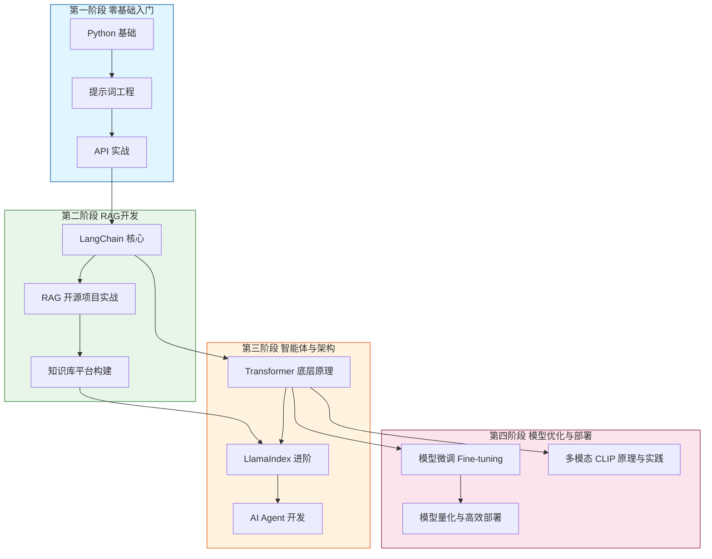

# 🚀 AI 大模型应用开发学习路线 (LLM Dev Roadmap)

> 一条从零基础到模型优化的 AI 大模型应用开发开源学习路径：**4 个阶段、13 个模块、31 个高 Star 项目**。
> 本项目不仅提供项目清单，更附带了以过来人视角总结的**难度分级、必学建议与避坑指南**。
> *注：Star 数据采集于 2026-11-20，通过 GitHub 官方 API 实时获取。*

---

## 👋 这个仓库适合谁

- 会 Python 基础语法、能看懂英文 README，但没做过 AI 应用的学生或初级开发者
- 想系统入门 LLM 应用开发，但面对海量项目不知道从哪开始的人
- 希望每个阶段结束时有一个能放进简历 / 作品集的产出物的人

## 🚫 不适合谁

- 完全不会编程：建议先从第一阶段「Python 基础」学起
- 已做过 AI 应用、在找进阶路径：这个仓库的深度不够

## 🧭 怎么用

按阶段顺序走，每个阶段末尾有「🎯 阶段产出物」，**做完产出物再进入下一阶段**。每个阶段预估 1—2 周（业余时间）。不需要全部做完才开始用 AI——阶段 1 结束时你就能写出可用的东西。

---

## 📖 目录 (Table of Contents)

- [👋 这个仓库适合谁](#-这个仓库适合谁)
- [🗺️ 核心学习路线图 (Roadmap)](#️-核心学习路线图-roadmap)
- [📚 详细学习路径与项目清单](#-详细学习路径与项目清单)
- [🧭 学习建议](#-学习建议)
- [🕳️ 新手最常踩的坑](#️-新手最常踩的坑)
- [🎯 学习成果自测 Checklist](#-学习成果自测-checklist)
- [🤝 如何贡献 (Contributing)](#-如何贡献-contributing)
- [License](#license)

---

## 🗺️ 核心学习路线图 (Roadmap)

建议按以下依赖关系循序渐进，切勿跳跃式学习：

---

## 📚 详细学习路径与项目清单

**💡 标签说明：**

- 🌟 **必学**：该模块的核心基石，强烈建议动手跑通。
- 💡 **推荐**：作为扩展视野或进阶提升的优质替代方案。
- 🟢 **直接可做**：有中文文档或免费额度、不需要 GPU、1 小时内能跑通。
- 🟡 **需要一点准备**：需要 API Key 或本地环境、约 2–3 小时起步、可能要读英文文档。
- 🔴 **需要前置知识**：需要 GPU、需要先理解某个框架或先完成前置项目。
- 每行的「前置要求」「预计耗时」两列帮你判断**现在能不能做**；学生党请优先看免费额度标注。

### 🐍 第一阶段：零基础入门

| 学习模块      | 推荐项目                                                                                                        | Star 数   | 难度    | 属性    | 前置要求                       | 预计耗时            | 一句话心得 / 避坑指南                                                                 |
| --------- | ----------------------------------------------------------------------------------------------------------- | -------- | ----- | ----- | -------------------------- | --------------- | ---------------------------------------------------------------------------- |
| Python 基础 | [jackfrued/Python-100-Days](https://github.com/jackfrued/Python-100-Days)                                   | ⭐ 187.9k | 🟢 入门 | 🌟 必学 | 无前置，免费                     | 选读前 15 天约 1–2 周 | 经典中文教程。避坑：不用全看！重点看前 15 天的语法和基础，后面的 Web 开发部分可以先跳过，直接进入 AI 库的学习。               |
| Python 基础 | [tangyudi/Ai-Learn](https://github.com/tangyudi/Ai-Learn)                                                   | ⭐ 13.5k  | 🟢 入门 | 💡 推荐 | 无前置，免费                     | 2–3 天           | 适合小白建立大局观。心得：跟着里面的实战案例敲代码，能快速消除对 AI 的陌生感。                                    |
| 提示词工程     | [dair-ai/Prompt-Engineering-Guide](https://github.com/dair-ai/Prompt-Engineering-Guide)                     | ⭐ 80.2k  | 🟢 入门 | 🌟 必学 | 无前置；英文（有中文译本）              | 2–3 天           | 提示词就是新时代的"编程语言"。心得：重点看 Few-shot 和 Chain-of-Thought (CoT) 章节，这是后面写 Agent 的基础。 |
| 提示词工程     | [anthropics/prompt-eng-interactive-tutorial](https://github.com/anthropics/prompt-eng-interactive-tutorial) | ⭐ 39.6k  | 🟢 入门 | 💡 推荐 | 需 Anthropic API Key（有免费额度） | 半天              | Anthropic 官方互动教程。心得：别光看文档，直接用 Jupyter Notebook 跑起来，立刻就能看到 Prompt 调整后的效果对比。   |
| API 实战    | [openai/openai-cookbook](https://github.com/openai/openai-cookbook)                                         | ⭐ 77.2k  | 🟢 入门 | 🌟 必学 | 需 API Key（按量付费，可换国产模型平替）   | 按需查阅            | 官方 API"字典"。避坑：不要从头读到尾，遇到具体需求（如流式输出、Function Calling）时，直接按目录搜对应的 Demo 抄代码。    |
| 入门导学      | [microsoft/generative-ai-for-beginners](https://github.com/microsoft/generative-ai-for-beginners)           | ⭐ 123.9k | 🟢 入门 | 🌟 必学 | 无前置；有中文翻译                  | 1–2 周           | 微软官方 21 节生成式 AI 入门课，每课配代码与视频。心得：把它当作全程的"地图"，后面任何模块学卡住了，都可以回来对应一课补课。          |
| 入门导学      | [dair-ai/ML-YouTube-Courses](https://github.com/dair-ai/ML-YouTube-Courses)                                 | ⭐ 17.5k  | 🟢 入门 | 💡 推荐 | 无前置；英文视频                   | 自选进度            | 机器学习 / AI 优质视频课程合集。心得：喜欢视频学习的从这里挑课，配合 Python-100-Days 边学边练效果最好。              |
| 提示词工程     | [f/prompts.chat](https://github.com/f/prompts.chat)                                                         | ⭐ 177.9k | 🟢 入门 | 💡 推荐 | 无前置，免费                     | 随手查阅            | 最大提示词合集（原 Awesome ChatGPT Prompts），直接抄着用。避坑：收藏不等于掌握，挑 10 个高频场景亲手改写一遍才算入门。    |

> **🎯 阶段产出物**：一个能跑的 LLM API 调用脚本 + 一份 10 条提示词模板
> **✅ 验证标准**：脚本能完成多轮对话并支持流式输出；10 条模板都来自你真实会用的场景，且各自跑通过一次。

### 🔍 第二阶段：RAG 开发

| 学习模块      | 推荐项目                                                                                      | Star 数   | 难度    | 属性    | 前置要求                          | 预计耗时     | 一句话心得 / 避坑指南                                                                  |
| --------- | ----------------------------------------------------------------------------------------- | -------- | ----- | ----- | ----------------------------- | -------- | ----------------------------------------------------------------------------- |
| LangChain | [langchain-ai/langchain](https://github.com/langchain-ai/langchain)                       | ⭐ 149.9k | 🟡 进阶 | 🌟 必学 | Python 熟练 + API Key           | 约 1 周    | 目前最主流的 LLM 应用框架。避坑：LangChain 更新极快，很多网上的老教程代码会报错，一定要看官方最新文档，建议先只学 LCEL 语法。     |
| LangChain | [chatchat-space/Langchain-Chatchat](https://github.com/chatchat-space/Langchain-Chatchat) | ⭐ 38.7k  | 🟡 进阶 | 💡 推荐 | 中文文档；Docker，建议 8G+ 显存或接在线 API | 1–2 天部署  | 适合想快速搭建私有知识库的人。心得：直接按文档一键部署，先跑通体验，再去研究它内部的 RAG 检索是怎么做的。                       |
| 项目实战      | [infiniflow/ragflow](https://github.com/infiniflow/ragflow)                               | ⭐ 94.5k  | 🔴 高阶 | 💡 推荐 | Docker；建议有 GPU                | 2–3 天    | 企业级 RAG 引擎。心得：它的深度文档解析（如处理复杂 PDF 表格）做得极好，做严肃商业项目可以参考它的架构。                     |
| 项目实战      | [HKUDS/LightRAG](https://github.com/HKUDS/LightRAG)                                       | ⭐ 40.8k  | 🟡 进阶 | 💡 推荐 | 先懂 RAG 基础 + API Key           | 2–3 天    | 知识图谱 + 双层检索。避坑：如果你的数据没有明显的实体关系（比如只是一堆散文），不要用这个，反而增加复杂度。适合处理长文本和强逻辑关系的文档。      |
| 知识库构建     | [run-llama/llama_index](https://github.com/run-llama/llama_index)                         | ⭐ 53.0k  | 🟡 进阶 | 🌟 必学 | Python + API Key；有中文社区教程      | 3–5 天    | RAG 构建神器，数据连接器极强。心得：LangChain 偏重流程编排，LlamaIndex 偏重数据索引与检索。做 RAG 时，两者结合使用效果最好。 |
| 知识库构建     | [langgenius/dify](https://github.com/langgenius/dify)                                     | ⭐ 161.5k | 🟢 入门 | 🌟 必学 | Docker；中文文档；可接免费额度模型          | 半天出 Demo | 可视化搭建 RAG 与 Agent 工作流的一体化平台。心得：拖拖拽拽就能出 demo，先快速建立成就感，再回头读源码理解工程实现。            |

> **🎯 阶段产出物**：一个本地知识库问答 Demo + 一份切分策略对比记录
> **✅ 验证标准**：Demo 能对 3 个预设问题返回带出处（来源文档 / 段落）的答案；至少对比过 2 种切分策略并记录了效果差异——这是"我不仅跑通了，还调过"的信号。

### 🤖 第三阶段：智能体与架构

| 学习模块        | 推荐项目                                                                            | Star 数   | 难度    | 属性    | 前置要求                         | 预计耗时      | 一句话心得 / 避坑指南                                                               |
| ----------- | ------------------------------------------------------------------------------- | -------- | ----- | ----- | ---------------------------- | --------- | -------------------------------------------------------------------------- |
| AI Agent    | [microsoft/autogen](https://github.com/microsoft/autogen)                       | ⭐ 61.9k  | 🟡 进阶 | 💡 推荐 | Python + API Key；英文文档        | 3–5 天     | 微软多智能体框架。心得：非常适合研究多 Agent 之间的通信机制，看它的官方示例能学到很多架构设计思路。                      |
| AI Agent    | [FoundationAgents/MetaGPT](https://github.com/FoundationAgents/MetaGPT)         | ⭐ 71.4k  | 🟡 进阶 | 💡 推荐 | Python + API Key；中文文档        | 2–3 天     | 角色扮演类 Agent 标杆。心得：看看它是如何通过 Prompt 把一个任务拆解成"产品经理、架构师、程序员"等角色的，非常开脑洞。        |
| AI Agent    | [crewAIInc/crewAI](https://github.com/crewAIInc/crewAI)                         | ⭐ 61.1k  | 🟡 进阶 | 🌟 必学 | Python + API Key             | 1–2 天     | 比 AutoGen 更易上手。避坑：不要把复杂的业务逻辑硬塞给 CrewAI，它更适合做流程清晰、角色明确的任务编排（比如自动化写周报）。      |
| Transformer | [datawhalechina/happy-llm](https://github.com/datawhalechina/happy-llm)         | ⭐ 35.0k  | 🔴 高阶 | 🌟 必学 | PyTorch 基础；中文教程              | 1–2 周     | 中文手搓大模型教程。心得：想彻底弄懂 Attention 机制，一定要跟着敲一遍，跑通一次前向传播，比看 100 篇原理解析都有用。         |
| Transformer | [rasbt/LLMs-from-scratch](https://github.com/rasbt/LLMs-from-scratch)           | ⭐ 108.7k | 🔴 高阶 | 💡 推荐 | PyTorch 基础；英文（有中文版配套书）       | 2–4 周     | 全球知名的硬核教程。避坑：需要一定的 PyTorch 基础，如果看不懂，先回去补 PyTorch，不要硬啃。                     |
| AI Agent    | [Significant-Gravitas/AutoGPT](https://github.com/Significant-Gravitas/AutoGPT) | ⭐ 188.1k | 🟡 进阶 | 💡 推荐 | Docker + API Key             | 1–2 天体验   | 自主智能体的开山项目。心得：重点看它的任务拆解与工具调用循环，这是后来所有 Agent 框架的思想源头。                       |
| AI Agent    | [All-Hands-AI/OpenHands](https://github.com/All-Hands-AI/OpenHands)             | ⭐ 93.9k  | 🔴 高阶 | 💡 推荐 | Docker + API Key             | 2–3 天     | AI 驱动的软件开发智能体（原 OpenDevin）。心得：想理解"AI 程序员"如何读写代码、执行命令，精读它的架构比刷十个 demo 收获都大。 |
| Transformer | [huggingface/transformers](https://github.com/huggingface/transformers)         | ⭐ 169.3k | 🟡 进阶 | 🌟 必学 | PyTorch 基础                   | 约 1 周（按需） | 预训练模型事实标准库。避坑：不要试图通读源码，先熟练掌握 pipeline 和 Trainer 两条主线，用到哪查到哪。               |
| Transformer | [karpathy/nanoGPT](https://github.com/karpathy/nanoGPT)                         | ⭐ 64.9k  | 🔴 高阶 | 💡 推荐 | PyTorch + GPU（可用 Colab 免费额度） | 2–3 天     | Karpathy 手写最小 GPT，千行代码训一个模型。心得：配合 happy-llm 一起敲，跑通一次完整训练，对架构的理解会质变。        |

> **🎯 阶段产出物**：一个带重试 / 降级逻辑的单 Agent 工作流 + 一份失败日志
> **✅ 验证标准**：故意制造一次工具调用失败，Agent 能按预期重试或降级，且失败日志完整可复盘——它把"我搭了个 Agent"升级为"我处理过 Agent 的失败"。

### ⚙️ 第四阶段：模型优化与部署

| 学习模块       | 推荐项目                                                                    | Star 数   | 难度    | 属性    | 前置要求                             | 预计耗时         | 一句话心得 / 避坑指南                                                        |
| ---------- | ----------------------------------------------------------------------- | -------- | ----- | ----- | -------------------------------- | ------------ | ------------------------------------------------------------------- |
| 微调         | [hiyouga/LLaMA-Factory](https://github.com/hiyouga/LLaMA-Factory)       | ⭐ 76.1k  | 🟡 进阶 | 🌟 必学 | 中文文档；GPU（可用 Colab / AutoDL 低价租用） | 1–2 天跑通 LoRA | 微调界的"傻瓜相机"。心得：支持模型极多，UI 界面极其友好。新手第一次跑微调（LoRA），用这个绝对有成就感，不易报错。       |
| 量化         | [microsoft/BitNet](https://github.com/microsoft/BitNet)                 | ⭐ 42.3k  | 🔴 高阶 | 💡 推荐 | 推理框架基础；以了解原理为主                   | 1 天读文档       | 微软 1-bit 大模型推理框架。心得：代表了前沿的极限量化技术，面试时聊到这个能极大加分。                      |
| 量化         | [kvcache-ai/ktransformers](https://github.com/kvcache-ai/ktransformers) | ⭐ 19.7k  | 🔴 高阶 | 💡 推荐 | 需要 GPU 环境                        | 先读架构文档再实操    | 异构推理优化。避坑：量化部署非常吃硬件配置，如果没有相应的 GPU 环境，建议先看懂它的架构文档，不要盲目实操。            |
| 多模态 (CLIP) | [mlfoundations/open_clip](https://github.com/mlfoundations/open_clip)   | ⭐ 14.3k  | 🟡 进阶 | 🌟 必学 | PyTorch + GPU                    | 3–5 天        | 跨模态基石。心得：理解"图文对齐"的最佳切入点，重点跑一下 Zero-shot 分类和图文检索的 Demo。              |
| 多模态 (CLIP) | [OFA-Sys/Chinese-CLIP](https://github.com/OFA-Sys/Chinese-CLIP)         | ⭐ 6.1k   | 🟡 进阶 | 💡 推荐 | 中文文档；GPU                         | 1–2 天        | 中文多模态首选。避坑：做中文电商图文检索或跨模态搜索，直接用这个，别用原版 CLIP，中文语义对齐效果好很多。             |
| 量化         | [ggml-org/llama.cpp](https://github.com/ggml-org/llama.cpp)             | ⭐ 135.8k | 🟡 进阶 | 🌟 必学 | 无 GPU 也可（CPU 推理）                 | 半天跑通         | C/C++ 本地推理引擎，GGUF 量化格式的发源地。心得：量化部署的核心基石，后续几乎所有"本地跑大模型"的工具都建立在它之上。   |
| 部署         | [ollama/ollama](https://github.com/ollama/ollama)                       | ⭐ 187.7k | 🟢 入门 | 🌟 必学 | 无前置；普通笔记本即可                      | 10 分钟        | 一行命令本地跑大模型。心得：学习期最省心的模型运行环境，与 LLaMA-Factory 组合即可覆盖大部分"微调 + 部署"实战场景。 |
| 多模态 (CLIP) | [openai/CLIP](https://github.com/openai/CLIP)                           | ⭐ 34.6k  | 🟡 进阶 | 💡 推荐 | PyTorch 基础                       | 1–2 天        | 图文跨模态模型的官方实现。心得：先读论文配套代码理解对比学习思想，再用 open_clip 做训练实践，一理论一动手正好闭环。     |

> **🎯 阶段产出物**：一次 LoRA 微调或量化实验记录 + 前后对比数据
> **✅ 验证标准**：同一组测试题在微调 / 量化前后的回答对比（截图或文字记录均可）。不需要跑出 SOTA，但要有"我动手调过"的证据。

---

## 🧭 学习建议

- **第一阶段**：边学边做 API 小项目，不要只看不动手。
- **RAG 阶段**：推荐「LangChain 学原理 + Dify 快速出 demo」的组合拳。
- **Agent 阶段**：先用 CrewAI 上手跑通，再读 AutoGen / OpenHands 的架构设计。
- **微调 / 量化**：用 LLaMA-Factory + Ollama 组合即可覆盖大部分实战场景。

> 💡 如果你想知道这些产出物如何被组织成可验证的能力证据（而不是散落在简历里的项目罗列），见 [ai-career-graph](https://github.com/yourname/ai-career-graph)。（*发布前请替换为真实仓库地址*）

---

## 🕳️ 新手最常踩的坑

这个仓库的差异化不在"列了 31 个项目"，而在"我知道你会卡在哪"。以下 6 条按"现象 → 原因 → 怎么办"整理：

1. **环境配了两天没跑起来**
   现象：卡在某个依赖版本报错。原因：教程写作时的版本和现在的最新版不一致。怎么办：优先用项目自带的 `requirements.txt` 或 Docker 镜像锁定环境；报错信息完整复制去搜索，关键词里加上你的版本号。
2. **报错看不懂，不知道搜什么**
   现象：面对一屏红色 traceback 无从下手。原因：新手常搜报错全文，搜不到就放弃。怎么办：只取报错最后一行的错误类型 + 关键名词（如 `CUDA out of memory`、`ModuleNotFoundError`），配上项目名去搜；Issue 区通常已有人踩过。
3. **项目跑通了，但不知道从哪个文件开始读**
   现象：star 了、部署了，然后就结束了。原因：缺少读代码的入口。怎么办：从官方文档的 Quickstart 对应的那个示例文件开始，给它加一行打印、改一个参数，看输出变化——"改得动"比"读得懂"更早建立掌控感。
4. **教程复现完就结束，不知道下一步做什么**
   现象：陷入"跟着做 → 跑通 → 换下一个教程"的循环。原因：缺一个自己的题目。怎么办：把教程里的示例数据换成你自己关心的数据（自己的笔记、收藏的文章），需求一变，你自然就知道下一步要改什么。
5. **免费额度用完了，被迫中断**
   现象：OpenAI 额度耗尽，实验停摆。原因：只配了一家 API。怎么办：优先用国产模型的免费额度（DeepSeek、通义、智谱均有新用户额度），或本地用 Ollama 跑开源小模型，本仓库清单中标注了各项目的免费替代路径。
6. **一上来就啃最难的项目**
   现象：第一周就去读 Transformers 源码，被劝退。原因：把"高 Star"等同于"先学"。怎么办：严格按阶段顺序走，每阶段的 🎯 产出物做完再升级——完成感是入门期最重要的燃料。

---

## 🎯 学习成果自测 Checklist

为了证明你真正掌握了上述路线，而不是仅仅"看过"，建议对照以下标准进行自测：

- [ ] **第一阶段**：能熟练调用 OpenAI / 国产大模型 API，并结合 Gradio 或 Streamlit 写出一个带有上下文记忆的对话机器人。
- [ ] **第二阶段**：能从零部署并跑通 Langchain-Chatchat 或 Dify，并能把一份 100 页的私有 PDF 准确灌入，实现精准问答。
- [ ] **第三阶段**：能使用 CrewAI 或 AutoGen 搭建一个包含 2 个以上角色的 Agent 团队，协作完成一项自动化任务（如：自动写代码并测试）。
- [ ] **第四阶段**：能使用 LLaMA-Factory 对开源小模型（如 Qwen-1.8B）进行 LoRA 微调，并通过 llama.cpp 完成量化，或用 Ollama 一键部署在本地笔记本上运行。

---

## 🤝 如何贡献 (Contributing)

开源项目离不开大家的支持！我们欢迎一切形式的贡献：

- **补充优质项目**：如果你觉得有比清单里更好的替代项目，欢迎提交 PR。
- **分享避坑经验**：如果你在学习上述项目时踩了坑，欢迎在 Issues 中分享，我们会更新到表格中。
- **纠正错误**：发现链接失效、介绍有误，请随时指出。

**操作指引：**

1. 提交 PR 前，请先阅读 [CONTRIBUTING.md](CONTRIBUTING.md)（如果暂无，可直接提 Issue）。
2. 如果你觉得本项目对你有帮助，请点亮右上角的 Star ⭐，这是对我们最大的鼓励！

---

## License

本项目以 [MIT License](LICENSE) 开源，内容部分遵循 [CC BY 4.0](https://creativecommons.org/licenses/by/4.0/)。
