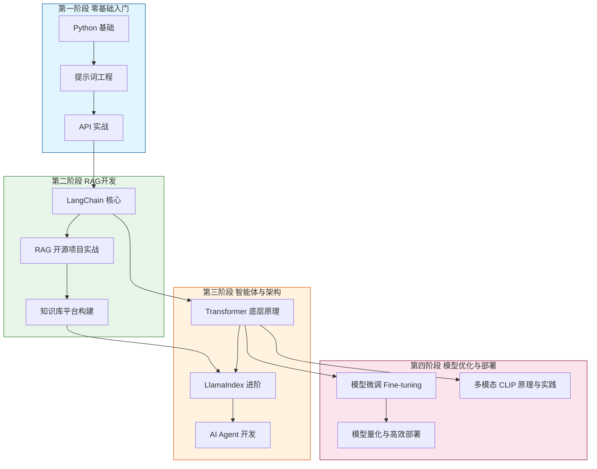

# 🚀 AI 大模型应用开发学习路线 (LLM Dev Roadmap)

> 一条从零基础到模型优化的 AI 大模型应用开发开源学习路径：**4 个阶段、12 个模块、20 个高 Star 项目**。
> 本项目不仅提供项目清单，更附带了以过来人视角总结的**难度分级、必学建议与避坑指南**。
> *注：Star 数据采集于 2026-11-20，通过 GitHub 官方 API 实时获取。*

---

## 📖 目录 (Table of Contents)
- [🗺️ 核心学习路线图 (Roadmap)](#️-核心学习路线图-roadmap)
- [📚 第一阶段：零基础入门](#-第一阶段零基础入门)
- [🔍 第二阶段：RAG 开发](#-第二阶段rag-开发)
- [🤖 第三阶段：智能体与架构](#-第三阶段智能体与架构)
- [⚙️ 第四阶段：模型优化](#️-第四阶段模型优化)
- [🎯 学习成果自测 Checklist](#-学习成果自测-checklist)
- [🤝 如何贡献](#-如何贡献)

---

## 🗺️ 核心学习路线图 (Roadmap)

建议按以下依赖关系循序渐进，切勿跳跃式学习：

